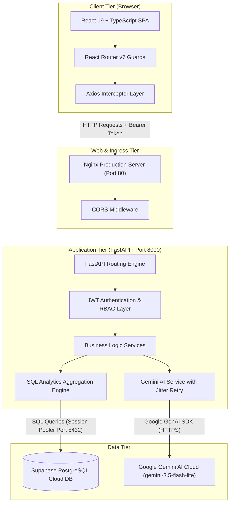
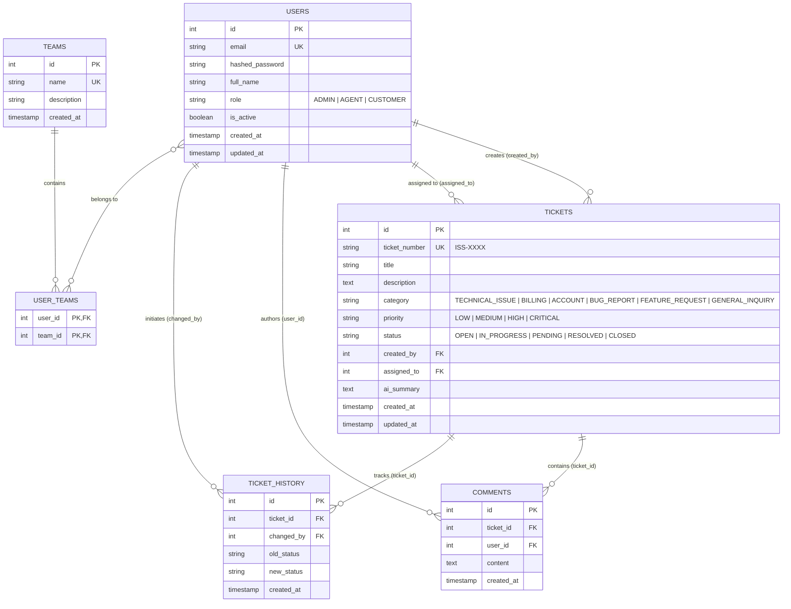
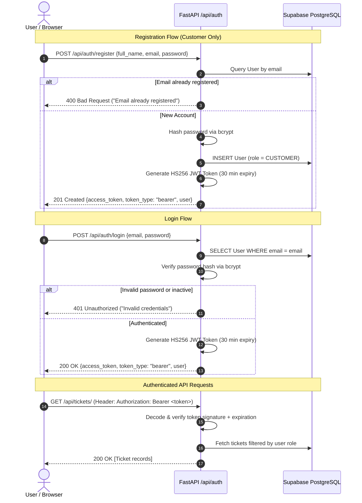
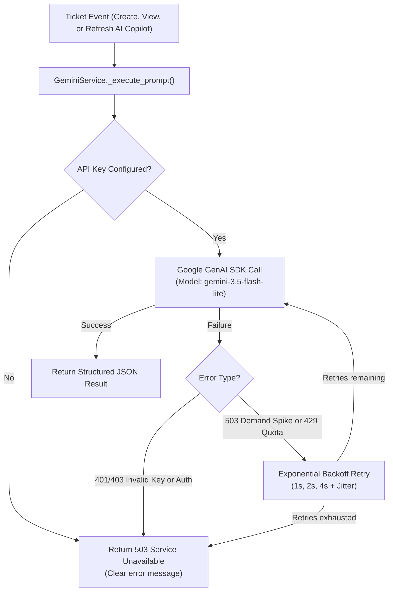

# IssueFlow – System Architecture & Technical Design

This document details the complete end-to-end architectural design, database entity relationships, request lifecycles, and security layers of the **IssueFlow** platform.

---

## 1. High-Level System Architecture



---

## 2. Database Entity-Relationship (ER) Schema

The database runs on **Supabase PostgreSQL** and is managed via **SQLAlchemy 2.0** ORM models and version-controlled **Alembic** migrations.



---

## 3. Authentication & JWT Lifecycle



---

## 4. Role-Based Access Control (RBAC) Matrix

| Endpoint / Operation | HTTP Method | Customer | Agent | Admin | Enforcement Mechanism |
| :--- | :---: | :---: | :---: | :---: | :--- |
| `/api/auth/register` | `POST` | Public | Public | Public | Forces `role = CUSTOMER` |
| `/api/auth/login` | `POST` | Public | Public | Public | Verifies bcrypt hash |
| `/api/auth/me` | `GET` | Own Profile | Own Profile | Own Profile | JWT Bearer dependency |
| `/api/tickets/` (List) | `GET` | Own Tickets | All Tickets | All Tickets | Filtered query `created_by == user.id` |
| `/api/tickets/{id}` | `GET` | Own Only | Allowed | Allowed | Returns 404/403 on IDOR attempts |
| `/api/tickets/` (Create)| `POST` | Allowed | Allowed | Allowed | Creator bound to JWT user ID |
| `/api/tickets/{id}` (Update)| `PUT` | Own Only | Allowed | Allowed | Customer restricted from status change |
| `/api/tickets/{id}/status` | `PATCH` | Forbidden | Allowed | Allowed | Requires `ADMIN` or `AGENT` role |
| `/api/tickets/{id}/assign` | `PATCH` | Forbidden | Allowed | Allowed | Requires `ADMIN` or `AGENT` role |
| `/api/tickets/{id}` (Delete)| `DELETE` | Forbidden | Forbidden | Allowed | Requires `ADMIN` role |
| `/api/comments/` (Create)| `POST` | Own Ticket | Any Ticket | Any Ticket | Customer restricted to own ticket |
| `/api/comments/{id}` (Delete)| `DELETE` | Own Only | Own Only | Any Comment | Author or Admin only |
| `/api/users/` (List / CRUD)| `GET/POST`| Forbidden | Forbidden | Allowed | Requires `ADMIN` role |
| `/api/teams/` (CRUD) | `GET/POST`| Forbidden | Forbidden | Allowed | Requires `ADMIN` role |
| `/api/analytics/overview` | `GET` | Allowed | Allowed | Allowed | Real-time SQL count aggregation |
| `/api/analytics/agent-performance` | `GET` | Forbidden | Allowed | Allowed | Requires `ADMIN` or `AGENT` role |
| `/api/ai/*` | `POST` | Own Ticket | Any Ticket | Any Ticket | IDOR validation on ticket_id |

---

## 5. Google Gemini AI Resilient Pipeline

The AI engine processes unstructured ticket data and generates triage insights through a resilient execution pipeline:



---

## 6. Live SQL Aggregated Analytics Engine

Unlike basic applications that calculate statistics in client-side memory or run multiple unindexed queries, IssueFlow aggregates metrics directly in Supabase PostgreSQL:

```sql
-- Status Distribution & Percentage Calculation (Single Query)
SELECT 
    status, 
    COUNT(id) AS count,
    ROUND((COUNT(id)::numeric / NULLIF((SELECT COUNT(*) FROM tickets), 0)::numeric) * 100, 1) AS percentage
FROM tickets
GROUP BY status;

-- Ticket Trends Grouped by Date (Truncated to Day)
SELECT 
    DATE_TRUNC('day', created_at)::date AS day,
    COUNT(id) AS created_count,
    COUNT(CASE WHEN status IN ('RESOLVED', 'CLOSED') THEN 1 END) AS resolved_count
FROM tickets
WHERE created_at >= NOW() - INTERVAL '30 days'
GROUP BY DATE_TRUNC('day', created_at)
ORDER BY day ASC;
```
This ensures sub-millisecond response times even as the ticket database scales to hundreds of thousands of records.

